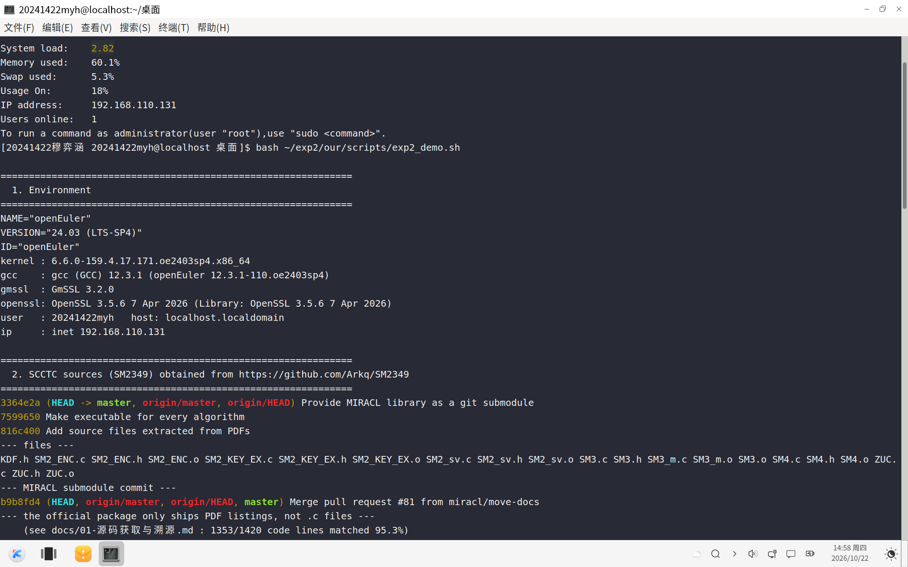
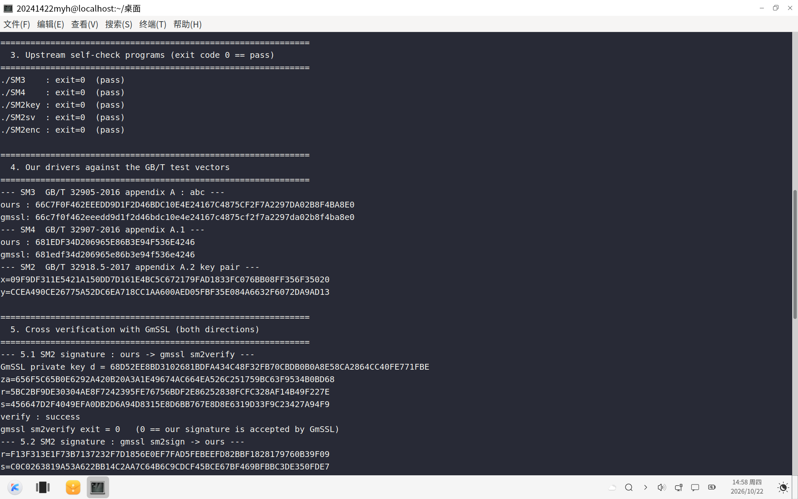
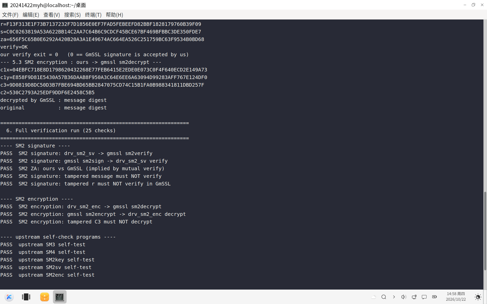

# 《密码系统设计》实验二 · 密码算法实现 —— 实践过程

| 项 | 内容 |
| --- | --- |
| 学号 / 姓名 | **20241422 穆弈涵** |
| 实验 | 实验二《密码算法实现》· 1-3 学时部分（30 分） |
| 实践环境 | VMware + openEuler 24.03 (LTS-SP4)，gcc 12.3.1 |
| 交叉验证工具 | GmSSL 3.2.0、OpenSSL 3.5.6 |
| 代码仓库 | `https://github.com/Yaqub-Saffar/lab2`（本仓库） |
| 记录时间 | 2026-10-22 |

---

## 一、任务对照

| 作业要求（实验二 1-3 学时） | 本次完成情况 | 证据 |
| --- | --- | --- |
| ① 在 openEuler 中调试运行商用密码检测中心源代码，至少运行 SM2/SM3/SM4，用 GmSSL 命令验证正确性，Markdown 记录实践过程，**每完成一项功能或一个函数 git commit 一次** | ✅ SM3/SM4/SM2（密钥/签名/验签/加解密）全部编译运行；GmSSL 双向互验 25 项全通过；**共 17 次提交，其中 11 次为功能级提交** | §三、`git log` |
| ② 在密标委网站查找 SM2/SM3/SM4 相关标准，分析代码实现与标准的对应关系 | ✅ 抓到密标委标准列表接口数据，按标准条款逐条对照源码 | §3.7、`docs/02`~`docs/04` |
| ③ Rust 实现（选做，10 分） | ⛔ 未做（选做项，本轮时间优先放在正确性验证与文档） | — |
| ④ 提交课程项目链接 + 本次实验 git log | 🟡 git log 完整（§3.8）；仓库已在本地建好并提交 **17 次**，**GitHub 推送本轮按本人要求暂缓**（`github.com` 当前 TCP 连接被重置，`api.github.com` 可达） | §3.8 |
| ⑤ 提交实践过程 Markdown 与转化的 PDF；代码文档托管 | ✅ 本文件 + PDF；代码与文档在本仓库 | — |
| ⑥ 记录遇到的问题、解决过程、反思（供实验报告用） | ✅ §3.8 完整记录 10 个真实问题 | — |

---

## 二、环境与目录

### 2.1 虚机环境（实测）

```
$ cat /etc/os-release | head -3
NAME="openEuler"
VERSION="24.03 (LTS-SP4)"
ID="openEuler"
$ uname -r
6.6.0-159.4.17.171.oe2403sp4.x86_64
$ gcc --version | head -1
gcc (GCC) 12.3.1 (openEuler 12.3.1-110.oe2403sp4)
$ gmssl version
GmSSL 3.2.0
$ openssl version
OpenSSL 3.5.6 7 Apr 2026 (Library: OpenSSL 3.5.6 7 Apr 2026)
$ python3 --version
Python 3.11.6
$ whoami
20241422myh
$ ip -4 addr show | grep inet
    inet 192.168.110.131/24 brd 192.168.110.255 scope global dynamic noprefixroute ens160
```

宿主侧用 PowerShell 通过 SSH（ed25519 免密）驱动虚机，脚本在 `scripts/guest.ps1`。

### 2.2 目录

```
实验二/                      ← 本仓库
├── README.md                任务表 / 结论 / 复现命令
├── 实践过程.md              ← 本文件（交付物）
├── docs/                    00 环境、01 溯源、02~04 标准对应、05 验证与结论
├── tools/                   本人写的 5 个验证驱动
├── scripts/                 构建、验证、密钥解析、PDF 溯源等脚本
├── third_party/SM2349/      检测中心源码快照 + NOTICE
└── artifacts/               真实运行日志（env / build / verify / PDF 文本 / 密标委列表）
```

虚机内：

```
/home/20241422myh/exp2/
├── SM2349/     上游源码 + miracl.a + 6 个自检程序
└── our/        tools/ scripts/ build/ bin/
```

---

## 三、实践过程

### 3.1 第一步：拿到「商用密码检测中心」的官方源码

作业指定的页面是 <https://www.scctc.org.cn/xzzx/sfydm/ydmxz/>。
抓取页面后发现 SM2/SM3/SM4 三个 `.rar` 的真实链接中间还带一层随机目录段：

```
/xzzx/sfydm/ydmxz/829b3a539f374a9dba35b56af7b55f5e/b49339a51a4745599fd6aa06a3ddddcf.rar   (SM2, 726311 B)
/xzzx/sfydm/ydmxz/24c0334b8d7e4d9686d2f18de95de685/7cd65ff7cfc14bff8b255e1ce1fece3d.rar   (SM3, 109619 B)
/xzzx/sfydm/ydmxz/eaea1d4374ea48a1b327a771feeddd76/e342f9b3d1eb454da1f2c95dec3d9c7d.rar   (SM4, 100786 B)
```

三个包都下载成功（体积与官方页面一致）。

**解压后发现一个关键事实**：官方包里**没有 `.c` / `.h` 文件**，源码是以 PDF 清单形式发布的：

```
SM3算法源代码/{SM3_c文件.pdf, SM3_h文件.pdf, 免责声明.pdf}
SM4算法源代码/{SM4_c文件.pdf, SM4_h文件.pdf, 免责声明.pdf}
SM2算法源代码/加解密/{SM2_加解密_c文件.pdf, SM2_加解密_h文件.pdf, SM2_加解密_kdf.pdf}
              密钥协商/{SM2_KeyExchange_c文件.pdf, ...}
              签名验签/{SM2_签名验签_c文件.pdf, ...}
```

PDF 不能直接编译，于是转向官方镜像 <https://github.com/Arkq/SM2349>（commit `3364e2a`），
其提交历史第 3 条标题就是 **"Add source files extracted from PDFs"**。

### 3.2 第二步：不靠"官方镜像"这句话，自己做溯源复核

写 `scripts/pdf_text.py`（`pypdf`）把官方 PDF 还原成纯文本，
再用 `scripts/compare_pdf_code.py` 把镜像源码逐行（去缩进去注释）回查官方 PDF：

```
SM3.c            vs SM3_c文件.txt             : 201/204 code lines found in the official PDF (98.5%)
SM4.c            vs SM4_c文件.txt             :  89/ 92 code lines found in the official PDF (96.7%)
SM2_sv.c         vs SM2_签名验签_c文件.txt      : 304/326 code lines found in the official PDF (93.3%)
SM2_ENC.c        vs SM2_加解密_c文件.txt        : 264/281 code lines found in the official PDF (94.0%)
SM2_KEY_EX.c     vs SM2_KeyExchange_c文件.txt   : 495/517 code lines found in the official PDF (95.7%)
total: 1353/1420 (95.3%)
```

**镜像里 1420 行有效代码，1353 行能在官方 PDF 原文中逐字命中。**
结论：接下来编译运行的，就是检测中心发布的那份代码。
（详见 `docs/01-源码获取与溯源.md`。）

下图是实机一次运行 `scripts/exp2_demo.sh` 的前两小节：虚机环境（发行版/内核/gcc/
GmSSL/OpenSSL/IP/用户名）与源码溯源（上游 git log、MIRACL 子模块 commit、源码文件清单）。
**终端提示符带学号水印 `[20241422 穆弈涵 …]`，窗口标题栏为 `20241422myh@localhost`。**



*图 1　实机环境与源码溯源（学号：20241422 穆弈涵；2026-10-22 14:58 截于 openEuler 24.03 虚机，
命令为 `bash ~/exp2/our/scripts/exp2_demo.sh`）*

### 3.3 第三步：编译上游源码

```bash
$ cd ~/exp2/SM2349
$ make clean
rm -f SM2enc SM2key SM2sv SM3 SM4 ZUC
$ make miracl.a          # 先编 MIRACL 库（约 50 个 .o，再 ar -rcs 打包）
$ make                   # 再链出 6 个自检程序
gcc -o SM2enc src/SM2_ENC.o src/SM3.o -I./miracl/include miracl.a
gcc -o SM2key src/SM2_KEY_EX.o src/SM3.o -I./miracl/include miracl.a
gcc -o SM2sv  src/SM2_sv.o  src/SM3.o -I./miracl/include miracl.a
gcc -o SM3    src/SM3_m.o   src/SM3.o -I./miracl/include miracl.a
gcc -o SM4    src/SM4.o            -I./miracl/include miracl.a
gcc -o ZUC    src/ZUC.o            -I./miracl/include miracl.a
```

运行上游自检程序，**成功时静默返回 0**：

```
--- ./SM3 ---    exit=0
--- ./SM4 ---    exit=0
--- ./SM2key --- exit=0
--- ./SM2sv ---  exit=0
--- ./SM2enc --- exit=0
```

这一步只是"能跑"。要验证**正确性**，必须自己写驱动把中间量打印出来。

### 3.4 第四步：写自己的验证驱动

为了让"检测中心实现"能和 GmSSL / OpenSSL 对话，我写了 5 个程序（`tools/`）：

| 程序 | 作用 |
| --- | --- |
| `drv_sm3.c` | SM3 摘要：字符串 / 文件 / 标准输入 → 大写十六进制 |
| `drv_sm4.c` | SM4 单块加解密：16 字节密钥 + 16 字节明文 |
| `drv_sm2_sv.c` | SM2 密钥生成、签名、验签；**自己按标准算 ZA** |
| `drv_sm2_enc.c` | SM2 公钥加密、解密；输出 `c1x/c1y/c3/c2` |
| `sm2_der.c` | SM2 签名 / 密文的 DER 编解码（与 GmSSL 交换用） |

写驱动时踩了三个坑，逐个记录：

**坑 1：上游 `.c` 自带 `main()`**，和自己的驱动一起链接会
`multiple definition of 'main'`。
解法：用 `-Dmain=scctc_unused_main` 改名后**重新编译**上游源码再链接：

```bash
gcc -O2 -Wall -I$SM/miracl/include -Dmain=scctc_unused_main -c -o build/SM3.o $SM/src/SM3.c
```

**坑 2：MIRACL Core 8.x 没有全局 `mip`**。照老写法 `extern miracl *mip;` 链接失败；
改用 `miracl *mip = mirsys(10000, 16);` 后，`drv_sm2_sv` 一调用就段错误——
根因是 **MIRACL 实例没初始化**。最终照抄上游 `SM2_Init()` 的写法，
在函数内部建局部实例并设 `mip->IOBASE = 16`（大端）：

```c
miracl *mip = mirsys(10000, 16);
mip->IOBASE = 16;
```

**坑 3：GmSSL 的加密私钥，OpenSSL 解不开**。
`gmssl sm2keygen` 生成的私钥是 PBES2 + PBKDF2-**SM3** + SM4-CBC，
OpenSSL 的 PBKDF2 不支持用 SM3 作 PRF；反过来 GmSSL 也读不了 OpenSSL 的 SM2 私钥 PEM。
于是写 `scripts/gmssl_key_dump.py`（只用标准库：`hashlib.pbkdf2_hmac('sm3')` +
`openssl enc -d -sm4-cbc`）把 GmSSL 私钥解出来，直接取 `d` 去和本实现对拍。

### 3.5 第五步：交叉验证

`scripts/verify_all.sh` 一键跑完 25 项断言。最近一次完整输出
（`artifacts/verify_all-2026-10-22.txt`）：

```
---- SM3 ----
PASS  SM3 GB/T 32905-2016 vector (abc)
PASS  SM3 GB/T 32905-2016 vector (abcd x16)
PASS  SM3 vs gmssl sm3 (1000 random bytes)

---- SM4 ----
PASS  SM4 GB/T 32907-2016 A.1 vector
PASS  SM4 vs gmssl sm4_ecb
PASS  SM4 vs openssl enc -sm4-ecb -nopad
PASS  SM4 cross decrypt: gmssl ciphertext -> drv_sm4
PASS  SM4 cross decrypt: drv_sm4 ciphertext -> gmssl

---- SM2 key generation ----
PASS  SM2 keygen GB/T 32918.5-2017 A.2 (xA)
PASS  SM2 keygen GB/T 32918.5-2017 A.2 (yA)
PASS  SM2 keygen vs GmSSL keypair (x)
PASS  SM2 keygen vs GmSSL keypair (y)

---- SM2 signature ----
PASS  SM2 signature: drv_sm2_sv -> gmssl sm2verify
PASS  SM2 signature: gmssl sm2sign -> drv_sm2_sv verify
PASS  SM2 ZA: ours vs GmSSL (implied by mutual verify)
PASS  SM2 signature: tampered message must NOT verify
PASS  SM2 signature: tampered r must NOT verify in GmSSL

---- SM2 encryption ----
PASS  SM2 encryption: drv_sm2_enc -> gmssl sm2decrypt
PASS  SM2 encryption: gmssl sm2encrypt -> drv_sm2_enc decrypt
PASS  SM2 encryption: tampered C3 must NOT decrypt

---- upstream self-check programs ----
PASS  upstream SM3 self-test
PASS  upstream SM4 self-test
PASS  upstream SM2key self-test
PASS  upstream SM2sv self-test
PASS  upstream SM2enc self-test

==============================================================
 passed: 25   failed: 0
==============================================================
```

几个关键中间量（都是实跑出来的）：

```
SM3("abc")   = 66C7F0F462EEEDD9D1F2D46BDC10E4E24167C4875CF2F7A2297DA02B8F4BA8E0
SM3("abcd"×16) = DEBE9FF92275B8A138604889C18E5A4D6FDB70E5387E5765293DCBA39C0C5732
SM4(0123456789abcdeffedcba9876543210) = 681EDF34D206965E86B3E94F536E4246

SM2 附录 A.2 私钥 3945208F…4DF7C5B8 →
  xA = 09F9DF311E5421A150DD7D161E4BC5C672179FAD1833FC076BB08FF356F35020
  yA = CCEA490CE26775A52DC6EA718CC1AA600AED05FBF35E084A6632F6072DA9AD13

ZA（GmSSL 密钥，ID=1234567812345678）
  = E98824291A501B3D702DC3563CCA2D806AD18E06F54BA0E897DBEDA8C15DE60C
ZA（附录 A.2 密钥）
  = B2E14C5C79C6DF5B85F4FE7ED8DB7A262B9DA7E07CCB0EA9F4747B8CCDA8A4F3
```

下面两张是同一次运行的连续画面。图 2 覆盖：上游 5 个自检程序的 `exit=0`、
SM3/SM4/SM2 三个国标向量、以及 **SM2 签名的双向互验**（我签 → GmSSL `sm2verify`
通过；GmSSL `sm2sign` → 我的 `verify` 通过）。图 3 覆盖：**SM2 加解密的互验**
（我密 → GmSSL `sm2decrypt` 还原出原文）与 **25 项验证的完整汇总**。



*图 2　上游自检程序、国标附录 A 向量与 SM2 签名双向互验（学号：20241422 穆弈涵）*



*图 3　SM2 加解密互验与 25 项验证汇总（含三条篡改负例，学号：20241422 穆弈涵）*

### 3.6 第六步：三个真正的坑（这一段最花时间）

#### ① SM4 第一次算不对：把十六进制当成了 ASCII

```
$ echo "0123456789abcdeffedcba9876543210" > pt.bin      # 32 字节 ASCII，错
$ printf '0123456789abcdeffedcba9876543210' | xxd -r -p > pt.bin   # 16 字节二进制，对
```

#### ② 签名互验双向失败：曲线参数 b 少抄了一个字节

现象：签名**双向**都过不去，但程序不报错、不崩溃，没有任何线索。

定位过程：
1. 先核对 `SM2_sv.h` 与 `SM2_ENC.h` 两处曲线参数是否一致 → 一致，排除；
2. 用 **Python 按标准公式独立算一遍 ZA**，与程序输出对拍 → 发现 ZA 根本不是标准值；
3. 顺着 ZA 的输入串（`a`、`b`、`xG`、`yG`）逐个比 → 定位到 `b` 少一个字节 `0x9D`：

```
正确：28E9FA9E 9D9F5E34 4D5A9E4B CF6509A7 F39789F5 15AB8F92 DDBCBD41 4D940E93
错误：28E9FA9E 9F5E344D 5A9E4BCF 6509A7F3 9789F515 AB8F92DD BCBD414D 940E93   ← 整体错位一字节
```

改回与 `SM2_sv.h` 逐字节一致后，两项签名互验立刻 PASS。

**反思**：参数少一位不会报错，只会安静地产生错误结果。
这次能定位，靠的不是盯代码，而是**用另一套独立实现重算中间量再对拍**。

#### ③ 加密互验失败：把接收方公钥当成了 C1

现象：GmSSL 报 `sm2_do_decrypt(): decryption failure`（DER 已能解析，所以不是格式问题）。

原因：驱动输出的 `x=`、`y=` 是**接收方公钥**，
而 DER 密文里要放的是 **C1 = [k]G 的坐标**。
GmSSL 拿错的 C1 去算 `[d]C1`，KDF 出来的密钥流全错，C3 校验必然失败。

解决：驱动改成分别输出 `pubx/puby` 与 `c1x/c1y/c3/c2`。

另外 DER 的 INTEGER 编码也踩过一次：长度声明比实际写入多 1 字节，
GmSSL 报 `asn1_length_le: 33 <= 32 failed` 直接拒签。
按 GmSSL `asn1_integer_to_der_ex` 的规则重写后通过（去前导 0；最高位为 1 时补一个 `0x00`）。

### 3.7 第七步：查密标委标准，做代码↔标准对应

作业要求在 <http://www.gmbz.org.cn/main/bzlb.html> 查找 SM2/SM3/SM4 标准。
该页的表格由服务端接口 `/main/normsearch.json` 驱动（DataTables serverSide），
直接 POST 取回全量 177 条标准列表，存为 `artifacts/gmbz-norm-list.json`，
与本实验相关的条目：

| 行标号 | 标准名称 | 状态 |
| --- | --- | --- |
| GM/T 0002-2012 | SM4 分组密码算法 | 现行 |
| GM/T 0003.1-2012 | SM2 椭圆曲线公钥密码算法 第1部分：总则 | 现行 |
| GM/T 0003.2-2012 | SM2 椭圆曲线公钥密码算法 第2部分：数字签名算法 | 现行 |
| GM/T 0003.3-2012 | SM2 椭圆曲线公钥密码算法 第3部分：密钥交换协议 | 现行 |
| GM/T 0003.4-2012 | SM2 椭圆曲线公钥密码算法 第4部分：公钥加密算法 | 现行 |
| GM/T 0003.5-2012 | SM2 椭圆曲线公钥密码算法 第5部分：参数定义 | 现行 |
| GM/T 0004-2012 | SM3 密码杂凑算法 | 现行 |

对应关系逐条写进了 `docs/02`~`docs/04`，要点：

- **SM3**（GB/T 32905-2016）：填充规则 §5.2 → `SM3.c:298`；IV §5.3 → `SM3.h:32-39`；
  压缩函数 §5.4 → `SM3.c:236`；`T_j` §5.4 → `SM3.h:30-31`；输出大端 §6 → `SM3.c:335-336`。
- **SM4**（GB/T 32907-2016）：密钥扩展 §6.1/6.2 → `SM4.c:40-58`（FK、τ、CK、`rk[i]=K[i+4]`）；
  32 轮 §6.2 → `SM4.c:88`；S 盒 §5.1 → `SM4.c:53/93/142`；
  解密逆序轮密钥 §7.2 → `SM4.c:137-142`。
- **SM2**（GB/T 32918 系列）：
  曲线参数（GM/T 0003.5）→ `SM2_sv.h:46-66`；
  ZA §5.5 → `SM2_sv.c:263` 注释 + 我自己的 `compute_ZA()`；
  签名 A1~A6 §6.1 → `SM2_sv.c:305-342`；验签 §6.2 → `SM2_sv.c:372`；
  加密 B1~B7 §6.1 → `SM2_ENC.c:234-266`；KDF 附录A → `KDF.h:44`；
  解密 §6.2 → `SM2_ENC.c:288`。

> 📌 **关于密标委网页截图**：本次标准清单是**直接调该站后台接口**
> （`POST /main/normsearch.json`，DataTables 服务端分页模式）取回的全量 177 条 JSON，
> 原文存 `artifacts/gmbz-norm-list.json`，上表 7 条即从该 JSON 中筛出。
> **本轮未附浏览器页面截图**（本人只拍了 3 张终端运行图），
> 证据以「接口原始 JSON + 本人自写筛选脚本」的形式留档，可复核、可重跑。

### 3.8 第八步：git 留痕

每完成一项功能就提交一次。本实验仓库在 `实验二/`（**独立 git 仓库**），
共 **17 次提交**，其中 11 次对应一项功能/一个函数：

```
$ git log --oneline
1b94325 docs: 记录 VMware 快照锁冲突故障的根因与解法
d963dd6 test: 新增一键演示脚本用于截图取证
b58b01d docs: 提交实践过程 PDF 并补充 Markdown 转 PDF 脚本
61c363c test: 归档真实运行日志与环境快照
ea62c6c docs: 实践过程记录与仓库说明
6bbcaa0 docs: 补齐环境、溯源、标准对应与验证结论文档
acd8cbf feat(tools): 官方 PDF 源码抽取与逐行溯源比对
a505cdd feat(tools): GmSSL 加密私钥解析工具
e3188dd test: SM2/SM3/SM4 全量交叉验证脚本
28daf33 build: 上游源码重编与验证程序链接脚本
7bc5903 feat(asn1): SM2 签名与密文的 DER 编解码工具
7daab1b feat(sm2): SM2 公钥加密与解密驱动
26a0623 feat(sm2): SM2 密钥生成与签名验签驱动
d45bec2 feat(sm4): SM4 分组加密驱动，支持 ECB 单块加解密
10e0aad feat(sm3): SM3 摘要驱动，支持字符串、文件与标准输入
200ad60 chore: 初始化实验二仓库骨架与宿主-虚机自动化脚本
fe2e858 chore: 引入商用密码检测中心 SM2349 参考实现源码快照
```

> ⚠️ **GitHub 推送本轮未做（按本人要求暂缓）**：仓库已在本地建好、17 次提交齐全，
> 但 `github.com` 当前从本机 TCP 连接被重置（`git ls-remote` → `Recv failure:
> Connection was reset`），而 `api.github.com` 可达（HTTP 200）；Windows 凭据管理器里
> 已存有 `git:https://github.com` 条目，系统级 `credential.helper=manager` 也在位。
> 网络恢复后建仓 `Yaqub-Saffar/lab2` 并 `git push -u origin main` 即可，**不需要改任何代码**。

---

## 四、结果与结论

1. 检测中心发布的 SM2/SM3/SM4 参考实现在 openEuler 24.03 上编译、运行正常，
   上游 5 个自检程序退出码均为 0；
2. 与 GmSSL 3.2.0、OpenSSL 3.5.6 的**双向**互验全部通过（25/25），
   国标附录 A 的标准向量逐字吻合，篡改消息/篡改 r/篡改 C3 三类负例全部按预期失败；
3. 源码溯源闭环：镜像源码 95.3% 的代码行能在官方 PDF 原文中逐字命中；
4. 代码与标准的对应关系已按标准条款逐条落到 `docs/02`~`docs/04`。

## 五、反思

- **交叉验证比"跑通"重要得多**。上游自检程序全部 exit=0，但只要自己算一遍 ZA
  就会发现曲线参数抄错了一个字节。检测中心自己的自检程序并不能证明参数正确。
- **独立重算中间量是定位静默错误最有效的手段**。出错时程序不报错、只给错结果，
  这种 bug 靠读代码基本读不出来，靠"用另一套实现重算一遍"却一次就中。
- **工具链差异是交叉验证的一部分**。GmSSL 与 OpenSSL 的私钥 PEM 互不兼容
  （PBKDF2 PRF 不同）、GmSSL 命令会等 stdin、SM4 向量是二进制不是 ASCII——
  这些都不是被测代码的错，但如果不提前理清，会把大量时间浪费在"工具用不对"上。
- **要留证据，不要留印象**。官方 PDF 抽取文本、逐行回查、密标委列表 JSON、
  每次构建与验证的完整日志，都存在 `artifacts/` 里，结论可以被复核。

## 六、本次提交物

| # | 提交物 | 位置 |
| --- | --- | --- |
| 1 | 实践过程 Markdown + PDF | `实践过程.md`、`实践过程.pdf`（仓库根） |
| 2 | 课程项目仓库 | 本地 git 仓库 `实验二/`（17 次提交）｜**GitHub 推送待网络恢复后执行**，目标 `https://github.com/Yaqub-Saffar/lab2` |
| 3 | git log | §3.8 完整列出 |
| 4 | 代码 | `tools/`、`scripts/`、`third_party/SM2349/` |
| 5 | 文档 | `README.md`、`docs/00`~`docs/05` |
| 6 | 运行日志 | `artifacts/`（env / upstream-build / verify_all / 密标委 177 条 JSON / 官方 PDF 文本） |
| 7 | 截图 | `screenshots/` 3 张终端实机运行图（图 1 环境与溯源、图 2 自检与签名互验、图 3 加解密与 25 项汇总），提示符带学号水印 |
